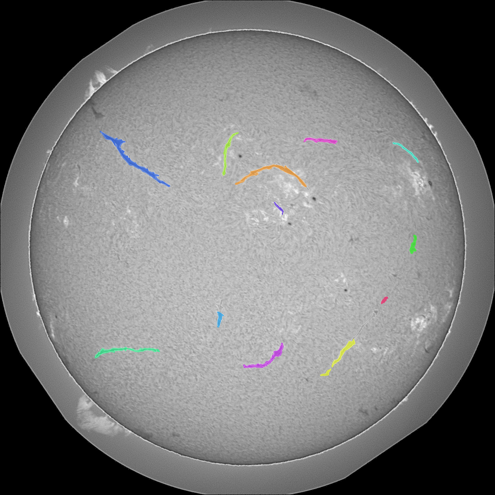
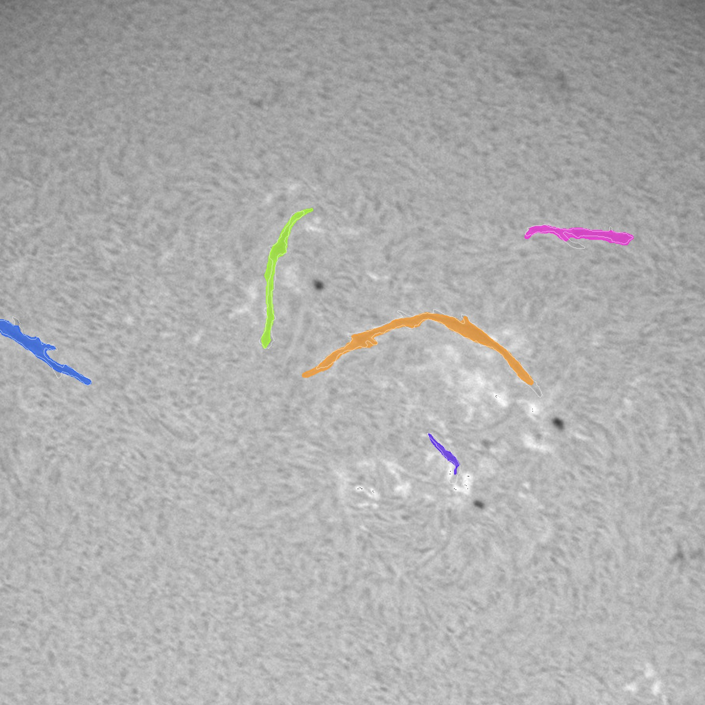

# Solar filament instance segmentation (IEEE BigData Cup 2026 / MAGFiLO)

Instance segmentation of solar filaments in 2048×2048 GONG H-alpha images.

**Final result:** honest 5-fold PQ (post-processing and rescorer tuned on the other folds) **0.458** on our date-grouped
cross-validation; public leaderboard 0.39.

## Reproduce the submission (no retraining)

1. `pip install -r requirements.txt` (pinned versions; Python 3.12, torch 2.15 + CUDA; a GPU gives ~0.3 s/image, CPU also works but is slow).
2. Download the competition data and place it at `filament-segmentation-2026/MAGFiLO_1.0_Kaggle_2026/`
   (containing `train/` and `test/`), or set `FILSEG_DATA` to that folder. The data is not redistributed here.
3. Run **`notebooks/pipeline.ipynb`** top to bottom. It loads the 15 committed checkpoints and the rescorer from `weights/`,
   predicts the 180 test images and writes `submission.csv` (the committed copy is the notebook's own output). The file actually uploaded to Kaggle is `submitted_v3_ens15.csv`; it was produced from cached probabilities of the same models, so the two agree up to GPU/fp16 numerical noise (mean per-image mask IoU 0.994, 1140 vs 1143 filaments).
   Optional section 3 scores a held-out fold with a re-implementation of the organizers' PQ scorer.

## Method (details in the technical report)

- U-Net (`segmentation_models_pytorch`, scSE decoder) with 3 outputs: filament mask, spine, boundary. Soft targets from the union of annotators.
- Ensemble of 15 models = 3 recipes (EfficientNetV2-S @768 crops, EfficientNetV2-S @1024 crops, ResNet34 @ full image) × 5 date-grouped folds.
  Flip TTA; probabilities averaged.
- Post-processing: hysteresis thresholding, shape-aware instance grouping, thin-structure calibration (`src/filseg/postprocess.py`),
  then a learned instance rescorer (gradient boosting, `weights/rescorer.pkl`) that drops likely false-positive instances; disjoint masks → COCO RLE.

## Example result

Held-out validation image (`20111112193254Bh`, never seen in training by these 3 fold-0 models). Coloured fill = our predicted filament instances, white outlines = annotator masks. Picked as a favourable example (Dice 0.79 vs. annotators); typical fold-0 PQ is 0.47. Faint/thin structures (e.g. the long faint filament at lower right) are the main failure mode.

Re-render with `python scripts/render_showcase.py` (writes full-resolution PNGs to `figures/`, which is git-ignored).

## Layout

| path | content |
|---|---|
| `notebooks/pipeline.ipynb` | full inference pipeline (generated by `scripts/build_notebook.py`) |
| `weights/` | 15 model checkpoints (`*.pt`, fp16) + `rescorer.pkl` |
| `submission.csv` | predictions regenerated by the notebook |
| `submitted_v3_ens15.csv` | file uploaded to Kaggle (public LB 0.39) |
| `src/filseg/` | library: data, model, training, inference, post-processing, rescoring, PQ scorer, RLE |
| `scripts/` | training queue, OOF caching, tuning, honest cross-fold evaluation, submission building |
| `configs/` | tuned post-processing parameters |
| `data/folds.csv` | date-grouped 5-fold split of the 707 training images |
| `PROGRESS.md`, `STRATEGY.md` | experiment log and plan |

Training (not needed for reproduction): `python -m filseg.train --help` (`PYTHONPATH=src`), see `scripts/queue_folds.sh`.
